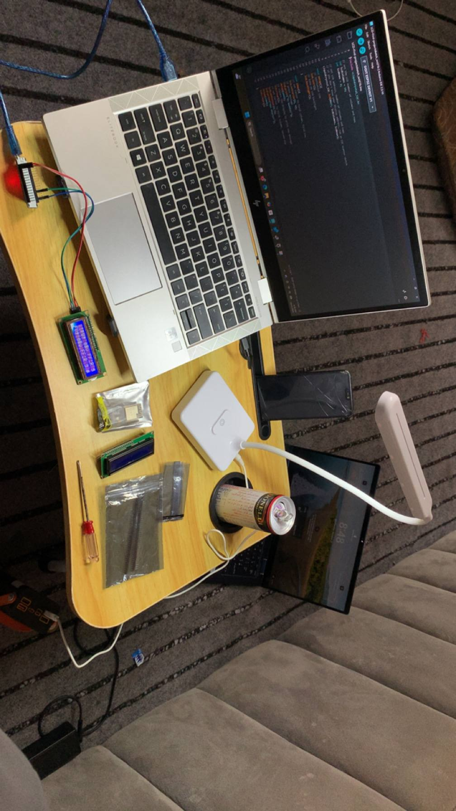

# ESP32 16x2 I2C LCD Display Module Project

This repository contains two core structural implementations for driving a 16x2 I2C Liquid Crystal Display (LCD) module using an ESP32 micro-controller board.

## 🛠️ Hardware Setup & Pins
Make sure your connections match the active physical circuit layout configurations:
* **GND** → ESP32 **GND** Pin
* **VCC** → ESP32 **VIN / 5V** Pin *(Required for correct character block contrast visibility)*
* **SDA** → ESP32 **GPIO 21**
* **SCL** → ESP32 **GPIO 22**

### Wiring & Output Reference
Here is the physical layout setup of the project environment:

---

## 💻 Firmware Varieties Inside This Repository

### 1. [Static Text Implementation](./Static_Text_16Chars/Static_Text_16Chars.ino)
Designed to load lightweight message parameters onto specific row segments without dynamic shifting logic arrays.

### 2. [Custom Scrolling Text Implementation](./Scrolling_Text/Scrolling_Text.ino)
Safely overrides the default character visibility limit array by buffering longer strings across active dynamic display windows.
